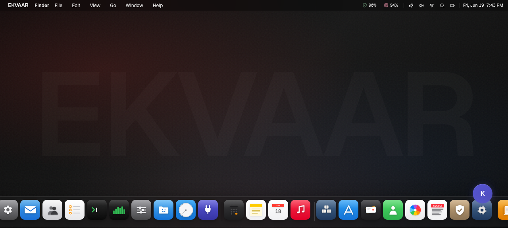
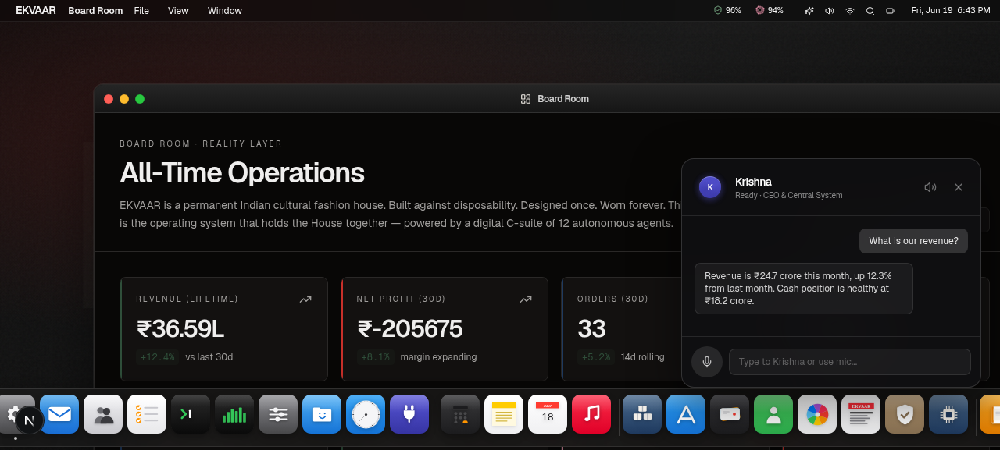
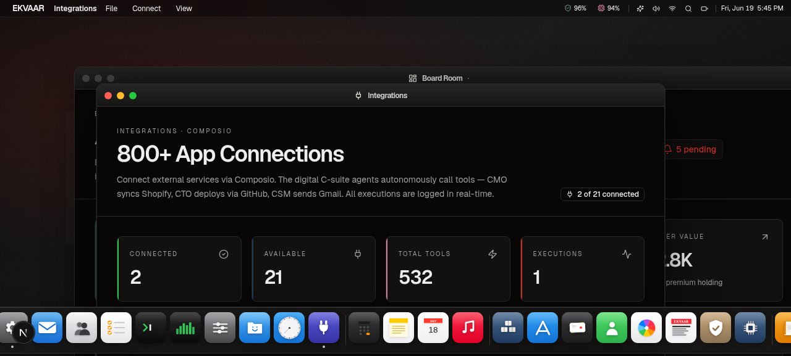
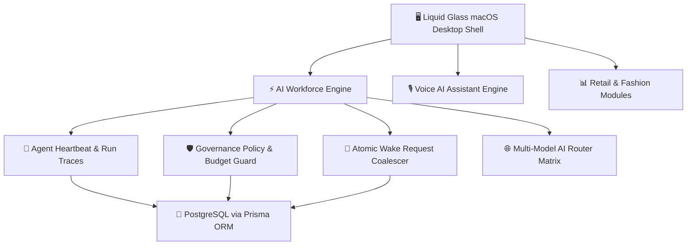

# 🌌 Fashion OS
**Open-Core Retail & E-Commerce Desktop Operating System**

[](https://github.com/KashinathTilagul)
[](https://github.com/KashinathTilagul/Ekvaar/releases)
[](https://github.com/KashinathTilagul/Ekvaar/blob/main/LICENSE)
[](https://supabase.com/)
[](https://nodejs.org/)
[](https://www.docker.com/)

---

## 💎 Overview

**Fashion OS** is a self-hostable open-core desktop operating system engineered for fashion brands, retail operations, and e-commerce infrastructure. Wrapped in a Liquid Glass macOS Desktop Environment and driven by an autonomous AI Workforce Control Plane, Fashion OS provides founders and operational teams with an integrated command center to manage sales, inventory, supply chain, automated workforce execution, and direct customer drops.

Created, architected, and maintained by **[Kashinath Tilagul](https://github.com/KashinathTilagul)** (EKVAAR).

<p align="center">
  
</p>

---

## 📸 Interface Preview

<div align="center">
  <table>
    <tr>
      <td width="50%">
        
        <p align="center"><b>Conversational AI & Command Center KPI Command</b></p>
      </td>
      <td width="50%">
        
        <p align="center"><b>800+ App Connections & Integrations Hub</b></p>
      </td>
    </tr>
  </table>
</div>

---

## 🏛️ System Architecture



---

## ⚡ Key Highlights & Core Capabilities

### 1. 🖥️ macOS Desktop Environment
- **Multi-Window Depth Layering**: Drag, resize, minimize, maximize, and stack windows with real z-index depth layering and frosted backdrop blur.
- **Top Menu Bar HUD**: Real-time system metrics, unread notification panel, system volume, battery indicator, and quick-launch AI triggers.
- **Global Spotlight (`Cmd+K`)**: Instant search across inventory SKUs, sales orders, digital employees, and system tools.
- **Launchpad Grid (`F4` / `Cmd+L`)**: Clean view of installed applications and retail modules.

### 2. 🤖 AI Workforce Control Plane
- **Org Chart & Directory**: Visual rendering of executive and specialist agent hierarchies (CEO, CMO, CTO, CFO, COO).
- **Kanban Task Boards**: Live tracking of production issues, marketing campaign deliverables, and product launches.
- **Governance Approvals Queue**: Enforces human founder sign-off before executing high-risk financial or operational decisions.
- **Real-Time Telemetry**: Execution steps, run logs, token consumption monitoring, and monthly spending caps.

### 3. 🎙️ Conversational Voice AI Sidecar
- **Continuous Voice Loop**: Hands-free speech-to-text input with silence auto-detection.
- **Natural Speech Pacing**: Sentence-chunked speech synthesis with pitch/rate tuning.
- **Multi-Model Intelligence**: Automatic fallback routing across Anthropic Claude, OpenAI, and local Ollama models.

---

## 🛍️ Fashion Operations & Retail Suite

| Module | Description | Core Capabilities |
| :--- | :--- | :--- |
| **Command Center** | Executive KPI Command | Real-time revenue analytics, active orders, acquisition cost, net margin |
| **Founder Inbox** | Priority Decision Queue | High-value transaction approvals, campaign sign-offs, agent overrides |
| **Sales & Orders** | Omnichannel Fulfillment | Order status, inventory dispatch, channels tracking (Shopify, Custom) |
| **Finance** | Financial Operations | Live P&L, expense tracking, margin analytics, payment reconciliation |
| **Inventory & Ops** | Supply Chain & SKUs | Real-time stock levels, supplier management, automated reorder points |
| **Campaigns** | Content & Marketing | Campaign planning, social media schedule, image asset generation |
| **Product Launches** | Autonomous Launch Pipeline | End-to-end product drops from research → Shopify publish |
| **Brand Intelligence** | Brand Identity Engine | Compliance scanner for visual assets, copy tone, and color guidelines |
| **Customers** | CRM & Community | Customer tiers, restoration tracking, VIP drop management |
| **AI Infrastructure** | Model & Provider Health | Multi-model router status, token spend, fallback monitoring |
| **Risk Center** | Governance & Approvals | Budget caps, approval queues, policy enforcement |
| **n8n Marketing Studio** | Embedded Automation | Workflow execution, marketing dispatch, embedded n8n runtime |
| **Integrations** | External Connectors | Shopify, Stripe, Razorpay, Slack, GitHub, Gmail connectors |

---

## 🧰 Built-in Desktop Utilities

- **Terminal**: Live event stream, worker logs, and system diagnostic execution.
- **Activity Monitor**: Real-time CPU, memory, and database pool utilization charts.
- **Files**: Integrated asset explorer for tech packs, lookbooks, campaigns, and reports.
- **Notes**: Markdown-powered notebook with local persistence.
- **Calendar**: Drop dates, marketing campaign schedules, and business milestones.
- **Music**: Ambient Web Audio synthesizer and soundscape player.
- **Calculator**: Quick financial and margin calculations.
- **Chat**: Conversational AI assistant interface.
- **Health Monitor**: System and service health status dashboard.
- **Memory Explorer**: Agent memory graph and knowledge visualization.
- **Knowledge Drive**: Workspace file management and artifact explorer.
- **Settings**: System appearance, accent colors, voice profiles, and governance controls.

---

## 🛡️ Enterprise Security & Governance

- **Budget Hard-Cap Safety**: Automatic token suspension upon hitting 100% threshold.
- **Input Sanitization**: XSS protection stripping malicious scripts and URI payloads across all endpoints.
- **Sensitive Data Redaction**: Automatic stripping of secrets, JWTs, and API credentials from log streams.
- **Rate-Limiting Matrix**: IP-bucket rate limiting protecting authentication and AI completion endpoints.
- **Security Headers**: Enforcement of `CSP`, `X-Frame-Options: DENY`, `X-Content-Type-Options: nosniff`, and `Strict-Transport-Security`.

---

## 🛠️ Technology Stack

```
Frontend    : Next.js 16 (App Router), React 19, TypeScript
Styling     : Tailwind CSS v4 + Liquid Glass Engine (glass-system.tsx)
Animation   : Framer Motion
State       : Zustand
Database    : PostgreSQL via Prisma ORM (Supabase Transaction Pooler)
Auth        : NextAuth v4 (Credentials Session Guard)
AI Engine   : Multi-Model Router (Anthropic Claude, OpenAI, Ollama)
Deployment  : Docker Compose + Nginx
```

---

## 🚀 Quick Start

```bash
# 1. Clone repository
git clone https://github.com/KashinathTilagul/Ekvaar.git
cd Ekvaar/apps/frontend

# 2. Install dependencies (the repository is Bun-locked)
bun install --frozen-lockfile

# 3. Generate Prisma Client and apply the schema
bun run db:generate
bun run db:push

# 4. Start local development server
bun run dev
```

Open [http://localhost:3000](http://localhost:3000) in your browser.

Redis-backed workers also require Redis. Docker users already get it through
Compose; for a host-only development server, start it separately and set
`REDIS_URL=redis://localhost:6379`.

### Supabase database URLs

Use the Supabase Transaction Pooler URL on port `6543` for `DATABASE_URL`, with
`pgbouncer=true`, and the Session Pooler URL on port `5432` for `DIRECT_URL`.
URL-encode special characters in the database password. `prisma.config.ts`
automatically prefers `DIRECT_URL` for CLI schema operations.

`NEXTAUTH_URL` and `NEXT_PUBLIC_APP_URL` must both exactly match the public OS
origin, including `https://` and without an extra path. AI, speech, and Composio
keys are intentionally configured per organization in Settings, never as shared
server environment variables.

---

## 🌐 Production Deployment

Deploy using the deployment script:

```bash
DOMAIN="os.yourdomain.com" ./deploy.sh
```

---

## 📄 License & Dual-Licensing Model

Created and maintained by **[Kashinath Tilagul](https://github.com/KashinathTilagul)** (`kashinathtilagul8@gmail.com`).

Distributed under an **Open Core License**:
- **Open Core Framework & UI**: Distributed under the permissive [MIT License](LICENSE).
- **Enterprise Autonomous Engine**: Dual-licensed under commercial terms for enterprise deployments.
