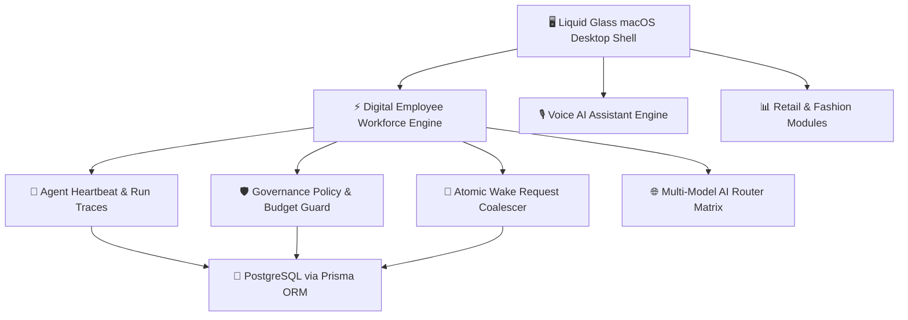

```
███████╗█████╗ ███████╗██╗██╗  ██╗██╗  ██╗███╗   ██╗     ██████╗ ███████╗
██╔════╝██╔══██╗██╔════╝██║██║  ██║██║  ██║████╗  ██║    ██╔═══██╗██╔════╝
█████╗  ███████║███████╗██║███████║██║  ██║██╔██╗ ██║    ██║   ██║███████╗
██╔══╝  ██╔══██║╚════██║██║██╔══██║██║  ██║██║╚██╗██║    ██║   ██║╚════██║
██║     ██║  ██║███████║██║██║  ██║╚█████╔╝██║ ╚████║    ╚██████╔╝███████║
╚═╝     ╚═╝  ╚═╝╚══════╝╚═╝╚═╝  ╚═╝ ╚════╝ ╚═╝  ╚═══╝     ╚═════╝ ╚══════╝
```

# 🌌 FASHION OS
### *Next-Generation Open-Source Fashion E-Commerce Operating System*

[](https://github.com/KashinathTilagul)
[](https://github.com/KashinathTilagul/Ekvaar/releases)
[](https://github.com/KashinathTilagul/Ekvaar)
[](https://supabase.com/)
[](https://nodejs.org/)
[](https://www.docker.com/)

---

## 💎 Overview

**Fashion OS** is a self-hostable, open-source desktop operating system engineered specifically for fashion brands, online retailers, and direct-to-consumer e-commerce enterprises. Wrapped in a **3D Liquid Glass macOS Desktop Environment** and driven by an autonomous **Digital Employee Control Plane**, Fashion OS provides founders and operators with an integrated command center to manage sales, inventory, supply chain, automated workforce execution, and direct customer drops.

Architected and maintained by **[Kashinath Tilagul](https://github.com/KashinathTilagul)** (EKVAAR), Fashion OS is released open-source under the MIT license for fashion businesses to deploy on their own custom domains and infrastructure.

---

## 📐 3D System Architecture Matrix

```
                      +------------------------------------------+
                      |    3D LIQUID GLASS macOS DESKTOP SHELL   |
                      |   (Spotlight, Dock, Window Depth Engine) |
                      +--------------------+---------------------+
                                           |
                   +-----------------------+-----------------------+
                   |                                               |
        +----------v----------+                         +----------v----------+
        |   DIGITAL WORKFORCE |                         |   CONVERSATIONAL    |
        |     CONTROL PLANE   |                         |   VOICE AI SIDECAR  |
        |  (Autonomous Mesh)  |                         |  (STT/TTS Neural)   |
        +----------+----------+                         +----------+----------+
                   |                                               |
                   +-----------------------+-----------------------+
                                           |
                      +--------------------v---------------------+
                      |      MULTI-MODEL AI ROUTING MATRIX       |
                      | (Claude 3.5 / GPT-4o / Local Ollama)     |
                      +--------------------+---------------------+
                                           |
                      +--------------------v---------------------+
                      |      POSTGRESQL / PRISMA PERSISTENCE     |
                      |     (Supabase Transaction Pooler)        |
                      +------------------------------------------+
```

### High-Level Flow Chart



---

## ⚡ Key Highlights & Core Capabilities

### 1. 🖥️ 3D Liquid Glass macOS Desktop Architecture
- **Depth Layering & Window Physics**: Drag, resize, minimize, maximize, and stack windows with real z-index depth layering and frosted backdrop filters.
- **Top Menu Bar HUD**: Real-time system metrics, unread notification panel, system volume, battery indicator, and quick-launch AI Assistant triggers.
- **Global Spotlight (`Cmd+K`)**: Instant fuzzy search across inventory SKUs, sales orders, digital employees, and system commands.
- **Full-Screen Launchpad (`F4` / `Cmd+L`)**: Grid interface for launching core retail modules and utilities.
- **Fluid Micro-Animations**: Dynamic visual feedback built with custom HSL token palettes and Framer Motion transitions.

### 2. 🤖 Autonomous Digital Employee Mesh
- **Overview & Org Chart**: Dynamic visual rendering of executive and specialist agent hierarchies (CEO, CMO, CTO, CFO, COO).
- **Kanban Task Boards**: Live tracking of issues, automated campaign deliverables, and product launches.
- **Governance Sign-off Queue**: High-risk financial or operational decisions require explicit founder approval.
- **Real-Time Telemetry**: Real-time run traces, log streams, token consumption monitoring, and monthly spending safety caps.

### 3. 🎙️ Conversational Voice AI Sidecar
- **Continuous Voice Loop**: Hands-free speech-to-text input with silence auto-detection.
- **Audio Queue Engine**: Natural-paced speech synthesis with pitch/rate tuning.
- **Automatic Model Fallback**: Dynamic routing across Anthropic Claude, OpenAI, and local Ollama models.

---

## 🛍️ Fashion Operations & Retail Suite

| Module | Description | Core Capabilities |
| :--- | :--- | :--- |
| **Board Room** | Executive KPI Command | Real-time revenue analytics, active orders, acquisition cost, net margin |
| **Founder Inbox** | Priority Decision Queue | High-value transaction approvals, campaign sign-offs, agent overrides |
| **Sales & Orders** | Omnichannel Fulfillment | Order status, inventory dispatch, channels tracking (Shopify, Custom) |
| **Finance** | Financial Operations | Live P&L, expense tracking, margin analytics, payment reconciliation |
| **Inventory & Ops** | Supply Chain & SKUs | Real-time stock levels, supplier management, automated reorder points |
| **Campaigns** | Content & Marketing | Campaign planning, social media schedule, image asset generation |
| **Brand Guardian** | Brand Identity Engine | Compliance scanner for visual assets, copy tone, and color guidelines |
| **Originals** | VIP Drop System | Member tiers, garment care tracking, exclusive product release drops |
| **Integrations** | External Connectors | Shopify, Stripe, Razorpay, Slack, GitHub, Gmail connectors |

---

## 🧰 Built-in Desktop Utilities

- **Terminal**: Live event stream, worker logs, and system diagnostic execution.
- **Activity Monitor**: Real-time CPU, memory, and database pool utilization charts.
- **Files**: Asset explorer for tech packs, lookbooks, campaigns, and reports.
- **Notes**: Markdown-powered notebook with local persistence.
- **Calendar**: Drop dates, marketing campaign schedules, and business milestones.
- **Music**: Ambient Web Audio synthesizer and soundscape player.
- **Settings**: System appearance, accent colors, voice profiles, and governance controls.

---

## 🛡️ Enterprise Security & Zero-Trust Governance

- **Budget Hard-Cap Safety**: Automatic token suspension upon hitting 100% threshold.
- **Input Sanitization**: XSS protection stripping malicious scripts and URI payloads across all endpoints.
- **Sensitive Data Redaction**: Automatic stripping of secrets, JWTs, and API credentials from log streams.
- **Rate-Limiting Matrix**: IP-bucket rate limiting protecting authentication and AI completion endpoints.
- **Security Headers**: Strict enforcement of `CSP`, `X-Frame-Options: DENY`, `X-Content-Type-Options: nosniff`, and `Strict-Transport-Security`.

---

## 🛠️ Technology Stack

```
Frontend    : Next.js 16 (App Router), React 19, TypeScript
Styling     : Tailwind CSS v4 + 3D Liquid Glass Engine (glass-system.tsx)
Animation   : Framer Motion
State       : Zustand
Database    : PostgreSQL via Prisma ORM (Supabase Transaction Pooler)
Auth        : NextAuth v4 (Credentials Session Guard)
AI Engine   : Multi-Model Router (Anthropic Claude, OpenAI, Ollama)
Deployment  : Docker Compose + Caddy / Nginx
```

---

## 🚀 Quick Start (Local Development)

```bash
# 1. Clone the repository
git clone https://github.com/KashinathTilagul/Ekvaar.git
cd Ekvaar/apps/frontend

# 2. Install dependencies
npm install

# 3. Initialize Prisma database schema
npx prisma db push

# 4. Start local development server
npm run dev
```

Open [http://localhost:3000](http://localhost:3000) in your browser.

---

## 🌐 Production Deployment

Deploy to any custom production server using the automated deployment script:

```bash
# Set your target domain and run deployment
DOMAIN="os.yourdomain.com" ./deploy.sh
```

### Pipeline Automated Execution:
1. Docker & container environment verification.
2. Production environment variable validation (`NEXTAUTH_SECRET`, `JWT_SECRET`).
3. Storage directory structure allocation (`storage/{pdf,images,videos}`).
4. Automated SSL certificate validation via Certbot.
5. Container image build and health check polling (`/api/health`).
6. Production smoke test suite execution.

---

## 📄 License & Maintainer

Maintained by **[Kashinath Tilagul](https://github.com/KashinathTilagul)** (`kashinathtilagul8@gmail.com`).  
Released under the **MIT License**. Free for personal, commercial, and enterprise deployment.
