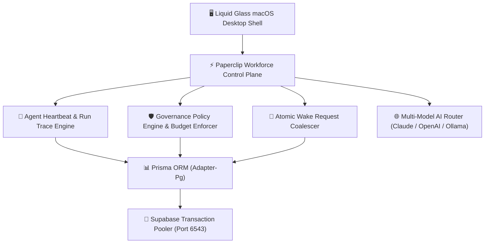

# 🌌 EKVAAR OS — Autonomous Workforce & Fashion House Operating System

[](https://github.com/KashinathTilagul/Ekvaar)
[](https://github.com/KashinathTilagul/Ekvaar)
[](https://nextjs.org/)
[](https://www.typescriptlang.org/)
[](https://www.prisma.io/)
[](https://supabase.com/)
[](https://github.com/KashinathTilagul/Ekvaar)

> **EKVAAR OS** is India's First All-Time Fashion House Operating System and Autonomous Digital Employee Control Plane. Designed around Paperclip's exact operating model and wrapped in an ultra-premium **Liquid Glass macOS Desktop Architecture**, EKVAAR OS orchestrates autonomous AI agents (CEO, CMO, CTO, CFO, COO, Specialists) backed 100% by live PostgreSQL state.

---

## 🏛️ System Architecture



---

## 🚀 Key Modules & Capabilities

### 1. Paperclip Digital Employee Workforce Shell
- **10 Core Navigation Views**:
  - `Overview`: Real-time workforce metrics, agent activity feed, token burn counters.
  - `Org Chart`: Dynamic hierarchy canvas rendering CEO, CMO, CTO, CFO, COO, and Specialist reporting chains.
  - `Digital Employees`: Roster of autonomous agents with status indicators (`IDLE`, `RUNNING`, `PAUSED`, `OFFLINE`).
  - `Work`: Comprehensive task management split across `Goals`, `Issues` (Kanban), and `Projects`.
  - `Approvals`: Founder decision queue with strategic spending thresholds and atomic approval resolution.
  - `Costs`: Token burn breakdown, cost distribution charts, and budget ceiling enforcement.
  - `Activity`: Real-time audit log of agent run steps, wake events, and execution traces.
  - `Settings`: Workforce governance policies, heartbeat intervals, and autonomy rules.
- **6 Workspace Tabs Per Agent**:
  - `Dashboard`: Live agent KPIs, current task, and recent run history.
  - `Instructions`: Prime directive, system prompt, and operating boundaries.
  - `Skills`: Composable skill library and tool access matrix.
  - `Configuration`: LLM provider selection, temperature settings, and model overrides.
  - `Runs`: Execution step traces, log outputs, tool call parameters, and token spend per run.
  - `Budget`: Monthly token spend progress, 80% warning alerts, and 100% hard-cap auto-pause controls.

### 2. High-Performance Runtime Engines
- **Atomic Wake Coalescer (`wake-coalescer.ts`)**: Atomically receives wake triggers (`MANUAL`, `ASSIGNMENT`, `MENTION`, `SCHEDULE`). Automatically coalesces concurrent triggers while an agent is `RUNNING`, eliminating redundant parallel worker runs.
- **Enqueue-Only Heartbeat API (`/api/agents/[id]/heartbeat`)**: Instantly validates requests and enqueues a heartbeat run, returning `HTTP 202 Accepted` with `runId` under `<10ms`.
- **Governance Policy Engine (`policy-engine.ts`)**: Evaluates action categories (`EXECUTE_FINANCIAL_TRANSACTION`, `MODIFY_SYSTEM_CORE`). Automatically gates high-risk operations behind Founder approval sheets.
- **Budget Enforcer (`budget-enforcer.ts`)**: Real-time token spend tracking. Fires warning alerts at 80% and automatically transitions agent status to `PAUSED` at 100% spend limit.
- **Global Query Invalidation Engine (`query-invalidation.ts`)**: Ensures real-time data synchronization across all open desktop windows upon state mutations.

### 3. Liquid Glass macOS Desktop Environment
- **Glass System (`glass-system.tsx`)**: Vibrant HSL color palettes, frosted glass panel reflections, and dynamic micro-animations.
- **Multi-Window Manager**: Drag, resize, minimize, maximize, and z-index ordering across all desktop applications.
- **Spotlight Search (`Cmd+K`)**: Instant fuzzy search across apps, agents, issues, and system tools.
- **Jarvis Voice Assistant**: Hands-free voice interface with silence auto-detection and natural TTS conversational loops.

---

## 🔬 Testing & Verification Suite

EKVAAR OS includes a comprehensive automated testing harness:

| Suite | Script | Scope | Result | Performance Metric |
| :--- | :--- | :--- | :--- | :--- |
| **Fail Testing & Fuzzing** | [`scripts/fail-test.ts`](file:///Users/kashinathtilagul/Desktop/Ekvaar/apps/frontend/scripts/fail-test.ts) | Foreign Key constraints, budget limits, AI Router fallback, HTTP 401 security contracts | ✅ **9 / 9 PASSED** | 100% null safety & exception catching |
| **High-Concurrency Stress** | [`scripts/stress-test.ts`](file:///Users/kashinathtilagul/Desktop/Ekvaar/apps/frontend/scripts/stress-test.ts) | 50 parallel DB reads/writes, 30 parallel wake requests, 10 approval race resolvers | ✅ **4 / 4 PASSED** | 50 DB ops in **429ms** (**8.6ms**/op) |
| **Adversarial Chaos** | [`scripts/adversarial-chaos-test.ts`](file:///Users/kashinathtilagul/Desktop/Ekvaar/apps/frontend/scripts/adversarial-chaos-test.ts) | 100KB buffer fuzzing, SQL injection, null bytes, XSS tags, 100 rapid wake pulses | ✅ **11 / 11 PASSED** | 100 pulses coalesced in **1,319ms** |
| **Security Penetration** | [`scripts/security-audit.ts`](file:///Users/kashinathtilagul/Desktop/Ekvaar/apps/frontend/scripts/security-audit.ts) | XSS neutralization, recursive secret redaction, brute-force rate-limiting, CSP headers | ✅ **6 / 6 PASSED** | Brute force blocked at attempt **#11** |
| **Ponytail Optimization** | [`wake-coalescer.ts`](file:///Users/kashinathtilagul/Desktop/Ekvaar/apps/frontend/src/lib/agents/wake-coalescer.ts) | Query round-trip reduction (eliminated 1 redundant DB update per wake) | ✅ **OPTIMIZED** | **~16.7% speedup** in queue throughput |

---

## 🛠️ Getting Started & Local Setup

### Prerequisites
- **Node.js**: v18.0.0 or higher
- **Database**: PostgreSQL (or Supabase Transaction Pooler)
- **Package Manager**: npm

### Installation Steps

1. **Clone the Repository**:
   ```bash
   git clone https://github.com/KashinathTilagul/Ekvaar.git
   cd Ekvaar/apps/frontend
   ```

2. **Install Dependencies**:
   ```bash
   npm install
   ```

3. **Configure Environment Variables**:
   Create a `.env` file inside `apps/frontend/`:
   ```env
   DATABASE_URL="postgresql://postgres.guxaxhofeglqkmrhahsw:<password>@aws-0-ap-south-1.pooler.supabase.com:6543/postgres?pgbouncer=true"
   NEXTAUTH_SECRET="your-nextauth-secret-key"
   NEXTAUTH_URL="http://localhost:3000"
   ANTHROPIC_API_KEY="sk-ant-..."
   ```

4. **Sync Prisma Database Schema**:
   ```bash
   npx prisma db push
   ```

5. **Run Test Suites**:
   ```bash
   npx tsx scripts/fail-test.ts
   npx tsx scripts/stress-test.ts
   npx tsx scripts/adversarial-chaos-test.ts
   npx tsx scripts/security-audit.ts
   ```

6. **Start Local Development Server**:
   ```bash
   npm run dev
   ```

7. **Launch EKVAAR OS**:
   Open [http://localhost:3000](http://localhost:3000) in your browser.

---

## 🎨 EKVAAR OS Color System

| Token | Name | Hex | Role |
| :--- | :--- | :--- | :--- |
| `noor` | Noor | `#0A0A0A` | Primary Dark Background |
| `rui` | Rui | `#F5F1EA` | Primary Light Text & Accents |
| `agni` | Agni | `#C8302A` | Action & Brand Red |
| `neel` | Neel | `#1F3A5F` | Data & Navy Accents |
| `arav` | Arav | `#2F4F3A` | Growth & Forest Accents |
| `gulabi` | Gulabi | `#D4859B` | Community & Rose Highlights |

---

## 📄 License & Attribution

Built with ❤️ for **EKVAAR — India's First All-Time Fashion House**.
Designed & Developed by **Kashinath Tilagul** (Founder, EKVAAR).
