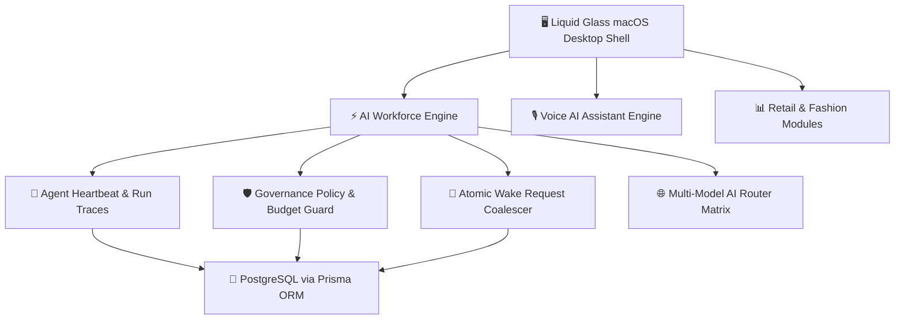

# 🌌 Commerce OS
**Open-Source Commerce Desktop Operating System**

[](https://github.com/KashinathTilagul)
[](https://github.com/KashinathTilagul/commerce-os/releases)
[](https://github.com/KashinathTilagul/commerce-os/blob/main/LICENSE)
[](https://www.postgresql.org/)
[](https://nodejs.org/)
[](https://www.docker.com/)

---

## 💎 Overview

**Commerce OS** is a self-hostable open-source desktop operating system engineered for commerce brands, retail teams, and e-commerce operations. Wrapped in a Liquid Glass macOS-style desktop shell and backed by an approval-gated AI Workforce Control Plane, Commerce OS gives founders and operational teams a single workspace to manage orders, inventory, finance, campaigns, product launches, brand intelligence, and organization-scoped integrations.

Created, architected, and maintained by **[Kashinath Tilagul](https://github.com/KashinathTilagul)** (EKVAAR).

<p align="center">
  
</p>

---

## 📸 Interface Preview

<div align="center">
  <table>
    <tr>
      <td width="50%">
        
        <p align="center"><b>Conversational AI & Command Center KPI Command</b></p>
      </td>
      <td width="50%">
        
        <p align="center"><b>800+ App Connections & Integrations Hub</b></p>
      </td>
    </tr>
  </table>
</div>

---

## 🏛️ System Architecture



---

## ⚡ Key Highlights & Core Capabilities

### 1. 🖥️ macOS Desktop Environment
- **Multi-Window Depth Layering**: Drag, resize, minimize, maximize, and stack windows with real z-index depth layering and frosted backdrop blur.
- **Top Menu Bar HUD**: Real-time system metrics, unread notification panel, system volume, battery indicator, and quick-launch AI triggers.
- **Global Spotlight (`Cmd+K`)**: Instant search across inventory SKUs, sales orders, digital employees, and system tools.
- **Launchpad Grid (`F4` / `Cmd+L`)**: Clean view of installed applications and retail modules.

### 2. 🤖 AI Workforce Control Plane
- **Org Chart & Directory**: Visual rendering of executive and specialist agent hierarchies (CEO, CMO, CTO, CFO, COO).
- **Kanban Task Boards**: Live tracking of production issues, marketing campaign deliverables, and product launches.
- **Governance Approvals Queue**: Enforces human founder sign-off before executing high-risk financial or operational decisions.
- **Real-Time Telemetry**: Execution steps, run logs, token consumption monitoring, and monthly spending caps.

### 3. 🎙️ Conversational Voice AI Sidecar
- **Continuous Voice Loop**: Hands-free speech-to-text input with silence auto-detection.
- **Natural Speech Pacing**: Sentence-chunked speech synthesis with pitch/rate tuning.
- **Multi-Model Intelligence**: Automatic fallback routing across Anthropic Claude, OpenAI, and local Ollama models.

---

## 🛍️ Fashion Operations & Retail Suite

| Module | Description | Core Capabilities |
| :--- | :--- | :--- |
| **Command Center** | Executive KPI Command | Real-time revenue analytics, active orders, acquisition cost, net margin |
| **Founder Inbox** | Priority Decision Queue | High-value transaction approvals, campaign sign-offs, agent overrides |
| **Sales & Orders** | Omnichannel Fulfillment | Order status, inventory dispatch, channels tracking (Shopify, Custom) |
| **Finance** | Financial Operations | Live P&L, expense tracking, margin analytics, payment reconciliation |
| **Inventory & Ops** | Supply Chain & SKUs | Real-time stock levels, supplier management, automated reorder points |
| **Campaigns** | Content & Marketing | Campaign planning, social media schedule, image asset generation |
| **Product Launches** | Autonomous Launch Pipeline | End-to-end product drops from research → Shopify publish |
| **Brand Intelligence** | Brand Identity Engine | Compliance scanner for visual assets, copy tone, and color guidelines |
| **Customers** | CRM & Community | Customer tiers, restoration tracking, VIP drop management |
| **AI Infrastructure** | Model & Provider Health | Multi-model router status, token spend, fallback monitoring |
| **Risk Center** | Governance & Approvals | Budget caps, approval queues, policy enforcement |
| **n8n Marketing Studio** | Embedded Automation | Workflow execution, marketing dispatch, embedded n8n runtime |
| **Integrations** | External Connectors | Shopify, Stripe, Razorpay, Slack, GitHub, Gmail connectors |

---

## 🧰 Built-in Desktop Utilities

- **Terminal**: Live event stream, worker logs, and system diagnostic execution.
- **Activity Monitor**: Real-time CPU, memory, and database pool utilization charts.
- **Files**: Integrated asset explorer for tech packs, lookbooks, campaigns, and reports.
- **Notes**: Markdown-powered notebook with local persistence.
- **Calendar**: Drop dates, marketing campaign schedules, and business milestones.
- **Music**: Ambient Web Audio synthesizer and soundscape player.
- **Calculator**: Quick financial and margin calculations.
- **Chat**: Conversational AI assistant interface.
- **Health Monitor**: System and service health status dashboard.
- **Memory Explorer**: Agent memory graph and knowledge visualization.
- **Knowledge Drive**: Workspace file management and artifact explorer.
- **Settings**: System appearance, accent colors, voice profiles, and governance controls.

---

## 🛡️ Enterprise Security & Governance

- **Budget Hard-Cap Safety**: Automatic token suspension upon hitting 100% threshold.
- **Input Sanitization**: XSS protection stripping malicious scripts and URI payloads across all endpoints.
- **Sensitive Data Redaction**: Automatic stripping of secrets, JWTs, and API credentials from log streams.
- **Rate-Limiting Matrix**: IP-bucket rate limiting protecting authentication and AI completion endpoints.
- **Security Headers**: Enforcement of `CSP`, `X-Frame-Options: DENY`, `X-Content-Type-Options: nosniff`, and `Strict-Transport-Security`.

---

## 🛠️ Technology Stack

```
Frontend    : Next.js 16 (App Router), React 19, TypeScript
Styling     : Tailwind CSS v4 + Liquid Glass Engine (glass-system.tsx)
Animation   : Framer Motion
State       : Zustand
Database    : PostgreSQL via Prisma ORM (Supabase Transaction Pooler)
Auth        : NextAuth v4 (Credentials Session Guard)
AI Engine   : Multi-Model Router (Anthropic Claude, OpenAI, Ollama)
Deployment  : Docker Compose + Nginx
```

---

## 🚀 Quick Start

### Option 1: Docker Compose (Recommended for Self-Hosting / Hostinger VPS)

```bash
# 1. Clone repository
git clone https://github.com/KashinathTilagul/commerce-os.git
cd commerce-os

# 2. (Optional) Customize domain and database credentials
cp .env.example .env

# 3. Start Commerce OS (PostgreSQL + Redis + Next.js app)
docker compose up -d --build
```

Open [http://localhost:3000](http://localhost:3000) (or your configured `NEXTAUTH_URL` / reverse-proxied domain) in your browser. On first boot, the container automatically runs database migrations and generates persistent runtime secrets in `apps/frontend/storage/.runtime-secrets` if you did not supply them in `.env`.

Optional Compose profiles are included for extended self-hosted services:
- `--profile ai`: adds OmniRoute, Python browser sidecar (`fastapi`), n8n, Cognee, Open-Design, Upskill, and Google Workspace CLI sidecars.
- `--profile proxy`: adds the Nginx reverse proxy (requires SSL certificates under `/etc/ssl/ekvaar`).
- `--profile workforce`: adds the private enterprise `vendor/rakazo` sandbox runtime (requires access to the private submodule).

### Option 2: Local Node.js Development

Requires Node.js `>=22.12`, PostgreSQL, and Redis.

```bash
# 1. Clone and install frontend dependencies
git clone https://github.com/KashinathTilagul/commerce-os.git
cd commerce-os/apps/frontend
npm ci --legacy-peer-deps

# 2. Generate Prisma Client and apply the schema
npx prisma generate
npm run db:push

# 3. Start local development server
npm run dev
```

Open [http://localhost:3000](http://localhost:3000) in your browser.

### Database & Origin Configuration

- **Self-hosted PostgreSQL:** Works directly with the bundled Docker `postgres` service or any PostgreSQL 16+ instance via `DATABASE_URL` and `DIRECT_URL`.
- **Supabase (optional):** Use the Supabase Transaction Pooler URL on port `6543` with `pgbouncer=true` for `DATABASE_URL`, and the Session Pooler URL on port `5432` for `DIRECT_URL`. `prisma.config.ts` automatically prefers `DIRECT_URL` for CLI schema operations.
- **Public URLs:** Set `NEXTAUTH_URL` and `NEXT_PUBLIC_APP_URL` to your exact public origin (e.g. `https://os.yourdomain.com`). AI, speech, and Composio keys are intentionally configured per organization in Settings rather than as shared server environment variables.

---

## 🌐 Production Deployment

For custom production domains with full sidecars, copy `.env.template` to `.env` and run:

```bash
DOMAIN="os.yourdomain.com" ./deploy.sh
```

---

## 📄 License

Created and maintained by **[Kashinath Tilagul](https://github.com/KashinathTilagul)** (`kashinathtilagul8@gmail.com`).

Distributed under the permissive [MIT License](LICENSE). Optional private enterprise extensions referenced by the `--profile workforce` Compose profile (`vendor/rakazo`) are maintained separately and are not required to run Commerce OS.
