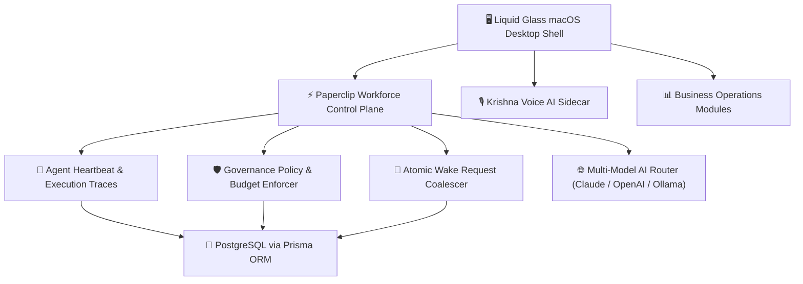

# 🌌 EKVAAR OS

**India's First All-Time Fashion House — Operating System**

[](https://nextjs.org/)
[](https://www.typescriptlang.org/)
[](https://www.prisma.io/)
[](https://supabase.com/)
[](https://tailwindcss.com/)

EKVAAR OS is a macOS-inspired desktop operating system built to run **EKVAAR**, India's premier fashion house, from a single unified interface. It combines business management (sales, inventory, finance, campaigns), autonomous digital employees (Paperclip operating model), and a conversational voice AI named Krishna.

---

## 🏛️ System Architecture



---

## 🖥️ Desktop OS Environment

### 1. macOS Shell Architecture
- **Window Management**: Multi-window environment supporting dragging, resizing, minimizing, maximizing, and z-index depth layering.
- **Top Menu Bar**: Live clock, unread notification panel, system metrics, audio volume slider, WiFi status, battery level indicator, and Krishna AI launch buttons.
- **Spotlight Search (`Cmd+K`)**: Global fuzzy search across apps, business metrics, digital employees, and system commands.
- **Launchpad (`F4` / `Cmd+L`)**: Full-screen grid view of all installed business and utility applications.
- **Liquid Glass Aesthetics**: Custom design system (`glass-system.tsx`) featuring vibrant HSL color palettes, frosted glass blur, and dynamic micro-animations.

### 2. Krishna — Conversational Voice AI Assistant
- **Voice Loop**: Hands-free speech recognition (STT) with silence auto-detection (2.2s pause threshold).
- **Jarvis-Style Speech Pacing**: Sentence-chunked SpeechSynthesis (TTS) with smooth audio queueing.
- **Multi-Model Intelligence**: Backed by an AI Router supporting Claude 3.5 Sonnet, OpenAI GPT-4o, and local Ollama models with automatic fallback chaining.

---

## 🤖 Digital Employees & Workforce Control Plane

EKVAAR OS integrates Paperclip's exact workforce operating model, providing autonomous digital employees with full operational transparency.

### 10 Core Control Plane Views
1. **Overview**: Executive dashboard showing active agent count, total token burn, live activity feed, and pending governance approvals.
2. **Org Chart**: Interactive visual canvas displaying reporting hierarchies across C-Suite (CEO, CMO, CTO, CFO, COO) and Specialist agents.
3. **Digital Employees**: Directory roster with real-time status badges (`IDLE`, `RUNNING`, `PAUSED`, `OFFLINE`).
4. **Work — Goals**: Strategic organizational objectives linked to team deliverables.
5. **Work — Issues**: Production Kanban board for tracking tasks, bugs, and automated agent assignments.
6. **Work — Projects**: Multi-stage campaign and product launch project boards.
7. **Approvals**: Founder decision queue enforcing strategic threshold sign-offs before high-risk actions execute.
8. **Costs**: Detailed token burn analytics, cost breakdowns by agent, and monthly spending projections.
9. **Activity**: Real-time audit log of agent run steps, wake events, tool invocations, and system events.
10. **Settings**: Workforce governance policies, heartbeat frequency, and autonomy level controls.

### 6 Workspace Tabs Per Agent
- **Dashboard**: Live performance metrics, current active task, and recent run history.
- **Instructions**: Agent prime directive, system prompt instructions, and operational boundaries.
- **Skills**: Composable skill library and tool access permissions.
- **Configuration**: LLM provider selection, temperature settings, and model overrides.
- **Runs**: Execution step traces, log outputs, tool call parameters, and token spend per run.
- **Budget**: Monthly token spend progress, 80% warning alerts, and 100% hard-cap auto-pause controls.

---

## 🛍️ Business Operations Modules

| Application | Description | Key Features |
| :--- | :--- | :--- |
| **Board Room** | Executive KPI Command Center | Real-time revenue, order volume, customer acquisition, brand health |
| **Founder Inbox** | Priority Decision Queue | High-value transaction approvals, campaign sign-offs, agent overrides |
| **Sales & Orders** | Omnichannel Sales Management | Order status, fulfillment tracking, channel breakdown (Shopify, Retail) |
| **Finance** | Financial Management | Live P&L, cash flow tracking, expense ledger, margin analytics |
| **Inventory & Ops** | Supply Chain Control | Stock levels, SKU catalog, supplier management, reorder points |
| **Campaigns** | Marketing & Content Hub | Pillar-based campaign builder, social media calendar, asset library |
| **Brand Guardian** | Brand Identity Enforcement | Compliance scanner for visual assets, copy tone, and guidelines |
| **Originals** | VIP Member Program | Member tiers, garment restoration tracking, exclusive drops |
| **AI Infrastructure** | LLM & Agent Telemetry | Provider response times, error rates, model fallback metrics |
| **Integrations** | External Service Connectors | Shopify, Stripe, Razorpay, Slack, GitHub, Gmail connectors |

---

## 🧰 Utility Applications

| App | Description |
| :--- | :--- |
| **Terminal** | Live system event stream, agent worker logs, and command execution |
| **Activity Monitor** | Real-time CPU, memory, and database connection pool utilization |
| **Files** | Integrated document explorer for brand assets, reports, and designs |
| **Notes** | Persistent founder notebook with markdown formatting |
| **Calendar** | Business schedule, product drop dates, and marketing events |
| **Music** | EKVAAR Sound — ambient Web Audio player with brand soundscapes |
| **Calculator** | Financial & margin calculator with quick formula presets |
| **Settings** | Desktop theme customization, accent colors, notifications, governance rules |

---

## 🛡️ Governance & Security System

- **Budget Hard-Cap Enforcement**: Automatic transition of agent status to `PAUSED` upon reaching 100% of allocated token budget.
- **Governance Policy Engine**: Automated evaluation of high-risk actions (`EXECUTE_FINANCIAL_TRANSACTION`, `MODIFY_SYSTEM_CORE`), placing them in `REQUIRE_APPROVAL` state.
- **Input Sanitization & XSS Neutralization**: All user inputs pass through recursive HTML sanitizers stripping `<script>` tags and `javascript:` URIs.
- **Sensitive Data Redaction Filter**: Automatic redaction of passwords, API keys, JWT access tokens, and secret keys in API outputs.
- **Rate-Limiting & Brute Force Protection**: IP-based rate limiting per bucket (`authLogin`, `chat`, `api`).
- **HTTP Header Hardening**: Server headers enforce `X-Frame-Options: DENY`, `X-Content-Type-Options: nosniff`, `Referrer-Policy: strict-origin-when-cross-origin`, and strict Content Security Policy.

---

## 🛠️ Technology Stack

| Layer | Technology |
| :--- | :--- |
| **Framework** | Next.js 16 (App Router, Turbopack) |
| **Language** | TypeScript 5.0 |
| **Styling** | Tailwind CSS v4 + Liquid Glass System (`glass-system.tsx`) |
| **Animation** | Framer Motion |
| **State Management** | Zustand |
| **Database** | PostgreSQL via Prisma 7.9 (Supabase Transaction Pooler) |
| **Authentication** | NextAuth v4 (Credentials) |
| **AI Models** | Anthropic Claude, OpenAI GPT-4o, Local Ollama via AI Router |
| **Voice Processing** | Web Speech API (STT) + SpeechSynthesis (TTS) |

---

## 🚀 Installation & Local Setup

### Prerequisites
- Node.js 18.0.0 or higher
- PostgreSQL database (or Supabase Connection Pooler)

### Setup Steps

1. **Clone the Repository**:
   ```bash
   git clone https://github.com/KashinathTilagul/Ekvaar.git
   cd Ekvaar/apps/frontend
   ```

2. **Install Dependencies**:
   ```bash
   npm install
   ```

3. **Configure Environment Variables**:
   Create a `.env` file in `apps/frontend/`:
   ```env
   DATABASE_URL="postgresql://postgres.guxaxhofeglqkmrhahsw:<password>@aws-0-ap-south-1.pooler.supabase.com:6543/postgres?pgbouncer=true"
   NEXTAUTH_SECRET="your-nextauth-secret-key"
   NEXTAUTH_URL="http://localhost:3000"
   ANTHROPIC_API_KEY="sk-ant-..."
   ```

4. **Initialize Database Schema**:
   ```bash
   npx prisma db push
   ```

5. **Start Development Server**:
   ```bash
   npm run dev
   ```

6. **Access EKVAAR OS**:
   Open [http://localhost:3000](http://localhost:3000) in your browser.

---

## 🎨 EKVAAR Brand Palette

| Token | Name | Hex | Role |
| :--- | :--- | :--- | :--- |
| `noor` | Noor | `#0A0A0A` | Primary Dark Background |
| `rui` | Rui | `#F5F1EA` | Primary Light Text & Accents |
| `agni` | Agni | `#C8302A` | Action & Brand Red |
| `neel` | Neel | `#1F3A5F` | Data & Navy Accents |
| `arav` | Arav | `#2F4F3A` | Growth & Forest Accents |
| `gulabi` | Gulabi | `#D4859B` | Community & Rose Highlights |

---

## 📄 License & Attribution

Built with ❤️ for **EKVAAR — India's First All-Time Fashion House**.  
Designed & Developed by **Kashinath Tilagul** (Founder, EKVAAR).
