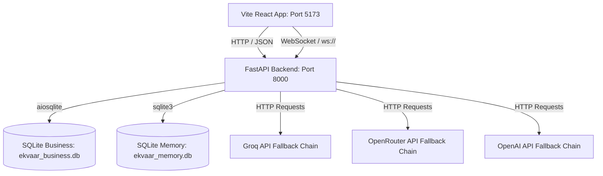

# EKVAAR OS V2 — EXHAUSTIVE SPECIFICATION & REPOSITORY ARCHITECTURE

This document represents the absolute authoritative specification of the EKVAAR OS V2 code structure, covering every layer, component, data store, and routing mechanism within the system.

---

## 1. System Topology & Process Layout



### Process Specifications
*   **React Frontend Process**: Powered by Vite 8.0, running on Node.js v20. It runs inside the `./apps/frontend/` working directory. Static files are generated into `dist/`. Dev mode is run via `npm run dev`.
*   **FastAPI Backend Process**: Powered by Python 3.14. Running on Uvicorn, bound to host `0.0.0.0` on port `8000`. Database actions utilize non-blocking `aiosqlite` threads. Dev mode is run via `py main.py`.

---

## 2. Exhaustive Repository Directory Tree

Below is the structured list of all active files and modules inside the repository (legacy temporary directories like `apps/backend/` and `src/` are fully deprecated and removed):

```
EKVAAR/
├── .env                              # Global API keys (GROQ, OPENROUTER, OPENAI, etc.)
├── .gitignore                        # Git ignore patterns
├── ARCHITECTURE_V2.md                # System V2 Architecture specs
├── blueprint.txt                     # System blueprint configuration references
├── calc-check.png                    # Assets
├── tahoe_contact.jpg                 # UI assets
├── apps/
│   ├── backend-py/                   # FASTAPI Backend Working Directory
│   │   ├── main.py                   # Main Uvicorn Server Entry Point
│   │   ├── requirements.txt          # Python Package Dependencies
│   │   ├── core/                     # Backend Subsystems
│   │   │   ├── __init__.py
│   │   │   ├── database.py           # SQLite connection & 28-table bootstrap schema
│   │   │   ├── agent/
│   │   │   │   ├── delegation.py     # Sub-agent coordination & simulated assignments
│   │   │   │   └── router.py         # Multi-provider LLM endpoint fallback client
│   │   │   ├── automation/
│   │   │   │   └── scheduler.py      # Async background Cron scheduler loop
│   │   │   ├── identity/
│   │   │   │   └── soul.md           # Persona definition guidelines for the AI
│   │   │   ├── memory/
│   │   │   │   └── memory_manager.py # Persistent sqlite chat log memory manager
│   │   │   └── skills/
│   │   │       └── executor.py       # Code executing registry sandbox
│   │   └── routes/                   # FastAPI APIRouters mounted under /api/
│   │       ├── __init__.py
│   │       ├── agent_routes.py       # Actions for execution: /tick, /approve, /skills
│   │       ├── content_routes.py     # Actions for data: /notes, /conversations, /calendar
│   │       ├── graph_routes.py       # Actions for telemetry: /metrics, /briefing, /export
│   │       └── shopify_routes.py     # Sync interface for e-commerce connections
│   │
│   └── frontend/                     # REACT Vite Workspace
│       ├── package.json              # NPM dependencies & scripts configuration
│       ├── vite.config.js            # Bundle chunks & optimization settings
│       ├── index.html                # App root html mount
│       ├── src/
│       │   ├── App.jsx               # Root entry, state providers wrap, global context loader
│       │   ├── main.jsx              # DOM client mounting point
│       │   ├── index.css             # Main styling, tahoe mat styles, system scrollbars
│       │   ├── ErrorBoundary.jsx     # Crash prevention layout
│       │   ├── components/
│       │   │   ├── Calculator.jsx    # Sleek world calculator utility
│       │   │   ├── AgentNetwork.jsx  # Swarm interface visually representing sub-agents
│       │   │   ├── apps/             # Independent Window OS Applications
│       │   │   │   ├── ActivityMonitor.jsx
│       │   │   │   ├── AppStore.jsx
│       │   │   │   ├── AutomationWorkspace.jsx
│       │   │   │   ├── Automator.jsx
│       │   │   │   ├── ClockApp.jsx
│       │   │   │   ├── CommunicationWorkspace.jsx
│       │   │   │   ├── Contacts.jsx
│       │   │   │   ├── Dictionary.jsx
│       │   │   │   ├── ExecutionWorkspace.jsx
│       │   │   │   ├── FashionNews.jsx
│       │   │   │   ├── FileExchange.jsx
│       │   │   │   ├── Finder.jsx
│       │   │   │   ├── FounderBrain.jsx
│       │   │   │   ├── Freeform.jsx
│       │   │   │   ├── HermesTerminal.jsx      # Standalone premium Hermes chat app
│       │   │   │   ├── IntelligenceWorkspace.jsx# Intelligence Center (signals, feed)
│       │   │   │   ├── KnowledgeVault.jsx
│       │   │   │   ├── Krishna.jsx
│       │   │   │   ├── Mail.jsx
│       │   │   │   ├── Maps.jsx
│       │   │   │   ├── MissionControl.jsx
│       │   │   │   ├── Music.jsx
│       │   │   │   ├── Notepad.jsx
│       │   │   │   ├── OperationsCalendar.jsx
│       │   │   │   ├── Photos.jsx
│       │   │   │   ├── PokerGame.jsx
│       │   │   │   ├── RelationshipInspector.jsx
│       │   │   │   ├── Reminders.jsx
│       │   │   │   ├── SocialHub.jsx
│       │   │   │   ├── SystemSettings.jsx
│       │   │   │   ├── SystemValidator.jsx
│       │   │   │   ├── Terminal.jsx
│       │   │   │   ├── VideoPlayer.jsx
│       │   │   │   ├── VirtualHQ.jsx
│       │   │   │   ├── Weather.jsx
│       │   │   │   └── Workspace.jsx
│       │   │   ├── os/             # OS Interface Elements
│       │   │   │   ├── BootManager.jsx
│       │   │   │   ├── CommandCenter.jsx
│       │   │   │   ├── CommandPalette.jsx
│       │   │   │   ├── ControlCenter.jsx
│       │   │   │   ├── Desktop.jsx
│       │   │   │   ├── DesktopShell.jsx
│       │   │   │   ├── Dock.jsx
│       │   │   │   ├── KrishnaOrb.jsx
│       │   │   │   ├── Launchpad.jsx
│       │   │   │   ├── MissionControl.jsx
│       │   │   │   ├── NotificationCenter.jsx
│       │   │   │   ├── RecoveryMode.jsx
│       │   │   │   ├── TopBar.jsx
│       │   │   │   ├── Window.jsx
│       │   │   │   ├── WindowManager.jsx
│       │   │   │   └── ToastContext.jsx
│       │   │   └── shared/          # Shared Tahoe Design System Primitives
│       │   │       ├── Badge.jsx
│       │   │       ├── Button.jsx
│       │   │       ├── Input.jsx
│       │   │       └── Surface.jsx
│       │   ├── store/               # Unified State Context Management
│       │   │   ├── AgentContext.jsx
│       │   │   ├── AutomationContext.jsx
│       │   │   ├── EventBusContext.jsx
│       │   │   ├── GraphContext.jsx
│       │   │   ├── OSContext.jsx
│       │   │   └── WorkflowEngineContext.jsx
```

---

## 3. Core Layer Subsystems (Exhaustive)

### Layer 1: Interaction Layer (I/O)
*   **Aesthetics**: Follows the Tahoe Design System (ultra-thick blur, liquid edges, dark surfaces, and styled borders).
*   **Window System (`components/os/Window.jsx`)**: Implements physics-based dragging, minimization, workspace assignments, active focus tracking, and coordinate persistence.
*   **Launchpad (`components/os/Launchpad.jsx`)**: Dynamically indexes the central `APPS` schema, providing search filtering and window initialization handlers.

### Layer 2: Intelligence Layer (Kernel)
*   **LLM Router (`core/agent/router.py`)**:
    - **groq**: Model `llama-3.1-8b-instant`. Target endpoint: `https://api.groq.com/openai/v1/chat/completions`.
    - **openrouter**: Model `meta-llama/llama-3.1-8b-instruct:free`. Target endpoint: `https://openrouter.ai/api/v1/chat/completions`.
    - **openai_fallback**: Model `gpt-4o-mini`. Target endpoint: `https://api.openai.com/v1/chat/completions`.
*   **Sub-Agent Delegation (`core/agent/delegation.py`)**: Defines state objects for autonomous actors. Runs task routing to map requirements to agent capability matches.

### Layer 3: Execution Layer (Automation)
*   **Scheduler (`core/automation/scheduler.py`)**: Orchestrates cron tasks utilizing async loops (`asyncio.create_task`).
*   **Skills Runner (`core/skills/executor.py`)**: Runs subprocess code calls (`subprocess.run`) and database query parsing.

### Layer 4: Persistence Layer
*   **`ekvaar_business.db` Database**: Autoritative 28 SQLite tables.
    - Schema mapping references: `orders` -> `order_line_items` -> `variants` -> `products`.
    - Execution mapping references: `decisions` -> `missions` -> `tasks` -> `plans` -> `outputs`.
    - Telemetry tracking: `graph_entities` & `graph_relationships` representing semantic graph connections.
*   **`ekvaar_memory.db` Database**: Appended logs mapping `threads`, `messages`, and context tag nodes.
