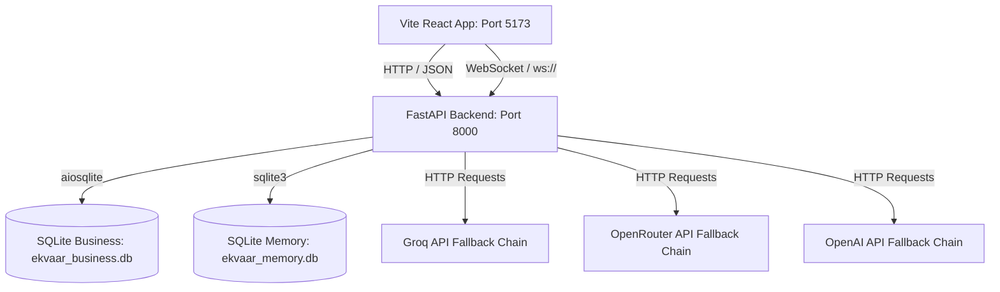

# EKVAAR OS V2 — EXHAUSTIVE SPECIFICATION & REPOSITORY ARCHITECTURE

This document represents the absolute authoritative specification of the EKVAAR OS V2 code structure, covering every layer, component, data store, and routing mechanism within the system.

---

## 1. Layered Architecture

EKVAAR OS operates on a strict 5-layer architecture. Data strictly flows down for storage and up for presentation.

1. **Interaction Layer (I/O)**: The only layer the Founder sees. Responsible for capturing raw intent (voice/text) and rendering dynamic, ephemeral components (Outputs, Metrics, Alerts).
2. **Kernel Layer (KRISHNA)**: The central nervous system. Intercepts intent, retrieves context, plans execution graphs, and manages global state routing.
3. **Execution Layer**: The active state machine. Manages the lifecycles of Missions, Initiatives, Projects, and Tasks. Operates the workforce (Agents and Persons).
4. **Governance Layer**: The rulebook. Operates strictly in the background to govern execution. Houses the Decision Registry, Metrics Engine, and Knowledge Vault.
5. **Persistence Layer**: The absolute bottom layer. An immutable graph and vector database where the primitive objects are stored.

---

## 2. System Topology & Process Layout



### Process Specifications
*   **React Frontend Process**: Powered by Vite 8.0, running on Node.js v20. It runs inside the `./apps/frontend/` working directory. Static files are generated into `dist/`. Dev mode is run via `npm run dev`.
*   **FastAPI Backend Process**: Powered by Python 3.14. Running on Uvicorn, bound to host `0.0.0.0` on port `8000`. Database actions utilize non-blocking `aiosqlite` threads. Dev mode is run via `py main.py`.

---

## 3. Exhaustive Repository Directory Tree

Below is the structured list of all active files and modules inside the repository (legacy temporary directories like `apps/backend/` and `src/` are fully deprecated and removed):

```
EKVAAR/
├── .env                              # Global API keys (GROQ, OPENROUTER, OPENAI, etc.)
├── .gitignore                        # Git ignore patterns
├── ARCHITECTURE_V2.md                # System V2 Architecture specs
├── blueprint.txt                     # System blueprint configuration references
├── calc-check.png                    # Assets
├── tahoe_contact.jpg                 # UI assets
├── apps/
│   ├── backend-py/                   # FASTAPI Backend Working Directory
│   │   ├── main.py                   # Main Uvicorn Server Entry Point
│   │   ├── requirements.txt          # Python Package Dependencies
│   │   ├── core/                     # Backend Subsystems
│   │   │   ├── __init__.py
│   │   │   ├── database.py           # SQLite connection & 28-table bootstrap schema
│   │   │   ├── agent/
│   │   │   │   ├── delegation.py     # Sub-agent coordination & simulated assignments
│   │   │   │   └── router.py         # Multi-provider LLM endpoint fallback client
│   │   │   ├── automation/
│   │   │   │   └── scheduler.py      # Async background Cron scheduler loop
│   │   │   ├── identity/
│   │   │   │   └── soul.md           # Persona definition guidelines for the AI
│   │   │   ├── memory/
│   │   │   │   └── memory_manager.py # Persistent sqlite chat log memory manager
│   │   │   └── skills/
│   │   │       └── executor.py       # Code executing registry sandbox
│   │   └── routes/                   # FastAPI APIRouters mounted under /api/
│   │       ├── __init__.py
│   │       ├── agent_routes.py       # Actions for execution: /tick, /approve, /skills
│   │       ├── content_routes.py     # Actions for data: /notes, /conversations, /calendar
│   │       ├── graph_routes.py       # Actions for telemetry: /metrics, /briefing, /export
│   │       └── shopify_routes.py     # Sync interface for e-commerce connections
│   │
│   └── frontend/                     # REACT Vite Workspace
│       ├── package.json              # NPM dependencies & scripts configuration
│       ├── vite.config.js            # Bundle chunks & optimization settings
│       ├── index.html                # App root html mount
│       ├── src/
│       │   ├── App.jsx               # Root entry, state providers wrap, global context loader
│       │   ├── main.jsx              # DOM client mounting point
│       │   ├── index.css             # Main styling, tahoe mat styles, system scrollbars
│       │   ├── ErrorBoundary.jsx     # Crash prevention layout
│       │   ├── components/
│       │   │   ├── Calculator.jsx    # Sleek world calculator utility
│       │   │   ├── AgentNetwork.jsx  # Swarm interface visually representing sub-agents
│       │   │   ├── apps/             # Independent Window OS Applications
│       │   │   │   ├── ActivityMonitor.jsx
│       │   │   │   ├── AppStore.jsx
│       │   │   │   ├── AutomationWorkspace.jsx
│       │   │   │   ├── Automator.jsx
│       │   │   │   ├── ClockApp.jsx
│       │   │   │   ├── CommunicationWorkspace.jsx
│       │   │   │   ├── Contacts.jsx
│       │   │   │   ├── Dictionary.jsx
│       │   │   │   ├── ExecutionWorkspace.jsx
│       │   │   │   ├── FashionNews.jsx
│       │   │   │   ├── FileExchange.jsx
│       │   │   │   ├── Finder.jsx
│       │   │   │   ├── FounderBrain.jsx
│       │   │   │   ├── Freeform.jsx
│       │   │   │   ├── HermesTerminal.jsx      # Standalone premium Hermes chat app
│       │   │   │   ├── IntelligenceWorkspace.jsx# Intelligence Center (signals, feed)
│       │   │   │   ├── KnowledgeVault.jsx
│       │   │   │   ├── Krishna.jsx
│       │   │   │   ├── Mail.jsx
│       │   │   │   ├── Maps.jsx
│       │   │   │   ├── MissionControl.jsx
│       │   │   │   ├── Music.jsx
│       │   │   │   ├── Notepad.jsx
│       │   │   │   ├── OperationsCalendar.jsx
│       │   │   │   ├── Photos.jsx
│       │   │   │   ├── PokerGame.jsx
│       │   │   │   ├── RelationshipInspector.jsx
│       │   │   │   ├── Reminders.jsx
│       │   │   │   ├── SocialHub.jsx
│       │   │   │   ├── SystemSettings.jsx
│       │   │   │   ├── SystemValidator.jsx
│       │   │   │   ├── Terminal.jsx
│       │   │   │   ├── VideoPlayer.jsx
│       │   │   │   ├── VirtualHQ.jsx
│       │   │   │   ├── Weather.jsx
│       │   │   │   └── Workspace.jsx
│       │   │   ├── os/             # OS Interface Elements
│       │   │   │   ├── BootManager.jsx
│       │   │   │   ├── CommandCenter.jsx
│       │   │   │   ├── CommandPalette.jsx
│       │   │   │   ├── ControlCenter.jsx
│       │   │   │   ├── Desktop.jsx
│       │   │   │   ├── DesktopShell.jsx
│       │   │   │   ├── Dock.jsx
│       │   │   │   ├── KrishnaOrb.jsx
│       │   │   │   ├── Launchpad.jsx
│       │   │   │   ├── MissionControl.jsx
│       │   │   │   ├── NotificationCenter.jsx
│       │   │   │   ├── RecoveryMode.jsx
│       │   │   │   ├── TopBar.jsx
│       │   │   │   ├── Window.jsx
│       │   │   │   ├── WindowManager.jsx
│       │   │   │   └── ToastContext.jsx
│       │   │   └── shared/          # Shared Tahoe Design System Primitives
│       │   │       ├── Badge.jsx
│       │   │       ├── Button.jsx
│       │   │       ├── Input.jsx
│       │   │       └── Surface.jsx
│       │   ├── store/               # Unified State Context Management
│       │   │   ├── AgentContext.jsx
│       │   │   ├── AutomationContext.jsx
│       │   │   ├── EventBusContext.jsx
│       │   │   ├── GraphContext.jsx
│       │   │   ├── OSContext.jsx
│       │   │   └── WorkflowEngineContext.jsx
│       │   └── utils/
│       └── public/
```

---

## 4. Core Layer Subsystems (Exhaustive)

### Layer 1: Interaction Layer (I/O)
*   **Aesthetics**: Follows the Tahoe Design System (ultra-thick blur, liquid edges, dark surfaces, and styled borders).
*   **Window System (`components/os/Window.jsx`)**: Implements physics-based dragging, minimization, workspace assignments, active focus tracking, and coordinate persistence.
*   **Launchpad (`components/os/Launchpad.jsx`)**: Dynamically indexes the central `APPS` schema, providing search filtering and window initialization handlers.

### Layer 2: Intelligence Layer (Kernel)
*   **LLM Router (`core/agent/router.py`)**:
    - **groq**: Model `llama-3.1-8b-instant`. Target endpoint: `https://api.groq.com/openai/v1/chat/completions`.
    - **openrouter**: Model `meta-llama/llama-3.1-8b-instruct:free`. Target endpoint: `https://openrouter.ai/api/v1/chat/completions`.
    - **openai_fallback**: Model `gpt-4o-mini`. Target endpoint: `https://api.openai.com/v1/chat/completions`.
*   **Sub-Agent Delegation (`core/agent/delegation.py`)**: Defines state objects for autonomous actors. Runs task routing to map requirements to agent capability matches.

### Layer 3: Execution Layer (Automation)
*   **Scheduler (`core/automation/scheduler.py`)**: Orchestrates cron tasks utilizing async loops (`asyncio.create_task`).
*   **Skills Runner (`core/skills/executor.py`)**: Runs subprocess code calls (`subprocess.run`) and database query parsing.

### Layer 4: Persistence Layer
*   **`ekvaar_business.db` Database**: Autoritative 28 SQLite tables.
    - Schema mapping references: `orders` -> `order_line_items` -> `variants` -> `products`.
    - Execution mapping references: `decisions` -> `missions` -> `tasks` -> `plans` -> `outputs`.
    - Telemetry tracking: `graph_entities` & `graph_relationships` representing semantic graph connections.
*   **`ekvaar_memory.db` Database**: Appended logs mapping `threads`, `messages`, and context tag nodes.

---

## 5. Object Ownership Model

Every Core Object has strict ownership and modification rights.

* **Mission**: Owned by Founder. Modified by Founder/KRISHNA. Archived by Founder. Relationships: Parent to Initiatives.
* **Initiative**: Owned by Leadership/KRISHNA. Modified by Leadership. Relationships: Parent to Projects, constrained by Decisions.
* **Project**: Owned by Person/Agent (Project Manager). Modified by Owner. Relationships: Parent to Tasks.
* **Task**: Owned by Agent/Person (Executor). Modified by Owner. Relationships: Triggers Output.
* **Output**: Owned by System. Immutable once approved. Modified via versioning (new Output). Relationships: Upstreams into Knowledge.
* **Decision**: Owned by Founder/Leadership. Global governance constraint. Cannot be archived, only superseded.
* **Knowledge**: Owned by System. Systematically updated by approved Outputs and external data.
* **Metric**: Owned by System. Updated automatically via Event triggers.
* **Agent**: Owned by KRISHNA. Spawned and terminated by the Kernel.
* **Person**: Managed by OS Identity System.

---

## 6. Relationship Graph

EKVAAR OS operates as a directed acyclic graph (DAG):

- **Mission** `contains` **Initiatives**.
- **Initiative** `contains` **Projects**.
- **Project** `contains` **Tasks**.
- **Task** `creates` **Output**.
- **Output** `updates` **Knowledge** and `alters` **Metrics**.
- **Decision** `constrains` (Mission, Initiative, Project, Task, Agent).
- **Knowledge** `contextualizes` (Mission, Initiative, Project, Task, Agent).
- **Agent/Person** `executes` **Task**.

---

## 7. Source of Truth Map

No data is duplicated. Every object has exactly one authoritative subsystem:

- **Knowledge** → Knowledge Vault (Vector/Semantic Database)
- **Decision** → Decision Registry (Immutable Append-Only Ledger)
- **Mission / Initiative / Project / Task** → Execution State Engine (Graph Database)
- **Output** → Artifact Store (Blob Storage)
- **Metric** → Telemetry Engine (Time-Series Database)
- **Agent / Person** → Entity Directory

---

## 8. Memory Architecture

* **What gets remembered**: Approved Outputs, locked Decisions, resolved Tasks, Meeting transcripts, verified Metrics.
* **What does not**: Intermediate Agent scratchpads, draft iterations, aborted Tasks, parsing errors, raw audio buffers.
* **How decisions are stored**: Appended to the immutable Decision Registry with cryptographic/timestamp hashing to ensure an unbreakable chain of command.
* **How institutional memory is preserved**: Memory is decoupled from human brains. When an Agent or Person begins a Task, the Context Engine automatically injects the exact Knowledge required. If an employee leaves, the operating system retains the exact context of how every Output was generated.

---

## 9. Permission Architecture

EKVAAR operates on a strict Role-Based Access Control (RBAC) model.

* **Founder**: 
  - *View*: Global. *Edit*: Global. *Approve*: Global. *Archive*: Global. *Ownership*: Root.
* **Leadership**: 
  - *View*: Domain-specific. *Edit*: Owned Initiatives/Projects. *Approve*: Owned Outputs. *Archive*: Domain-specific.
* **Employee**: 
  - *View*: Relevant Projects. *Edit*: Assigned Tasks. *Approve*: None (must request).
* **Vendor**: 
  - *View*: Only assigned Tasks. *Edit*: Only assigned Outputs.
* **AI Agent**: 
  - *View*: Systematically granted via Context Engine (Read-Only). *Edit*: Only assigned Outputs. *Approve*: None.

---

## 10. Event Architecture

The OS is entirely event-driven. Subsystems only react to emitted events via the Event Bus.

**Core Events:**
* `INTENT_RECEIVED`
* `COMMAND_PARSED`
* `MISSION_CREATED`
* `TASK_ASSIGNED`
* `TASK_BLOCKED`
* `OUTPUT_SUBMITTED`
* `OUTPUT_APPROVED`
* `OUTPUT_REJECTED`
* `DECISION_LOCKED`
* `KNOWLEDGE_INDEXED`
* `METRIC_THRESHOLD_CROSSED`

---

## 11. V1 System Blueprint

To prevent feature creep, Version 1 of EKVAAR OS will strictly contain:

**Included in V1:**
- **Layer 1 & 2**: Text/Voice Interaction Layer + simplified KRISHNA Kernel (Intent Parser + Agent Router).
- **Layer 3**: Basic Execution Flow (Missions → Tasks → Outputs). *Initiatives and Projects are skipped in V1 to reduce friction.*
- **Layer 4**: Single Knowledge Vault (Basic Retrieval-Augmented Generation). Decisions and Metrics are deferred.
- **Layer 5**: Single generalized Database.
- **Roles**: "Founder Mode" only (Global permissions). Multi-user and permissions are stripped from V1.
- **Agents**: A single General-Purpose Agent rather than a routed swarm.

**Excluded from V1:**
- Complex Planning Engines (No automatic multi-tier DAG generation).
- Initiative and Project objects.
- Multi-user RBAC.
- Metric telemetry engines.

---

## 12. Krishna Architecture

KRISHNA is broken down into 5 independent subsystems running concurrently:

**1. Intent Parser**
* **Purpose**: Translates raw human input into machine commands.
* **Inputs**: Voice/Text string.
* **Outputs**: Structured `CommandObject` (Action, Target, Constraints).
* **Dependencies**: None.

**2. Context Engine**
* **Purpose**: Retrieves the necessary background information before execution begins.
* **Inputs**: `CommandObject`.
* **Outputs**: `EnrichedCommand` (Command + relevant Knowledge + Constraints).
* **Dependencies**: Knowledge Vault, Decision Registry.

**3. Planning Engine**
* **Purpose**: Breaks a complex intent down into the Execution Flow graph.
* **Inputs**: `EnrichedCommand`.
* **Outputs**: A mapped DAG of (Initiatives → Projects → Tasks).
* **Dependencies**: Execution State Engine.

**4. Agent Router**
* **Purpose**: Assigns executable leaf-nodes (Tasks) to the correct resource.
* **Inputs**: Unassigned Tasks.
* **Outputs**: Active Agent executions.
* **Dependencies**: Entity Directory.

**5. Memory Engine**
* **Purpose**: Closes the loop by storing results.
* **Inputs**: Approved Outputs, Locked Decisions.
* **Outputs**: Indexed vectors in the Knowledge Vault.
* **Dependencies**: Artifact Store.

---

## 13. Intent → Execution Pipeline

**Example: Founder says "Launch Luxe Collection."**

1. **Ingest**: Interaction Layer captures audio, converts to text.
2. **Parse**: Intent Parser identifies goal: `Create Mission: Launch Luxe Collection`.
3. **Contextualize**: Context Engine retrieves past launch playbooks and the brand guidelines for "Luxe".
4. **Plan**: Planning Engine generates the tree:
   - *Mission*: Launch Luxe Collection
   - *Initiative*: Marketing Campaign
   - *Project*: Social Media Assets
   - *Task*: Draft Instagram Ad Copy
5. **Route**: Agent Router assigns "Draft Instagram Ad Copy" to the `Copywriter Agent`.
6. **Execute**: Agent consumes the brand guidelines (Knowledge) and completes the Task.
7. **Deliver**: Agent creates an `Output` object (the copy).
8. **Approve**: Interaction Layer surfaces the `Output` to the Founder.
9. **Finalize**: Founder approves. Memory Engine permanently indexes the `Output` into the Knowledge Vault, and the Task is marked `Completed`.
