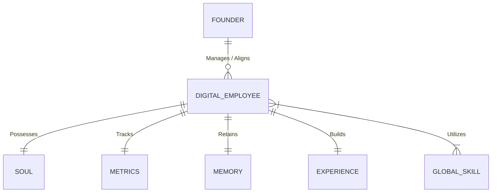

# Digital Workforce Data Model

This document outlines the data model supporting the EKVAAR OS Digital Employees.

## Core Entities

### 1. Digital Employee (`Profile`)
The central entity representing a member of the organization.
* `id`: UUID
* `position`: String
* `department`: String
* `reporting_to`: UUID (Manager's ID)
* `capacity`: Integer
* `current_load`: Integer
* `soul_id`: UUID (Refers to the `Soul` entity)
* `metrics_id`: UUID (Refers to `Metrics`)
* `memory_id`: UUID (Refers to `Memory`)
* `experience_id`: UUID (Refers to `Experience`)

### 2. Soul (`soul.md`)
Defines the identity, persona, and guardrails of the employee.
* `employee_id`: UUID
* `name`: String
* `profile_photo_url`: String
* `persona_description`: Text
* `capabilities`: List[String]
* `guardrails`: List[String]

### 3. Skills Map (`Skills`)
Skills are independent entities residing in a global directory. Employees have access to specific skills.
* `employee_id`: UUID
* `skill_ids`: List[UUID]
* *Global Skills contain:*
  * `id`: UUID
  * `domain`: String
  * `knowledge`: Text
  * `frameworks`: List[Text]
  * `playbooks`: List[Text]
  * `best_practices`: List[Text]

### 4. Memory (`memory.md`)
Long-term context and historical record.
* `employee_id`: UUID
* `long_term_memories`: List[Text]
* `key_decisions`: List[Dict] (Context, Decision, Rationale)
* `lessons_learned`: List[Text]

### 5. Experience (`experience.md`)
Record of executed tasks and outcomes.
* `employee_id`: UUID
* `completed_tasks`: List[Dict] (Task ID, Description)
* `outcomes`: List[Text]
* `failures`: List[Text]
* `successes`: List[Text]

### 6. Metrics (`metrics.md`)
Performance tracking data.
* `employee_id`: UUID
* `productivity`: Float
* `accuracy`: Float
* `decision_quality_score`: Float
* `avg_response_time_ms`: Integer
* `task_completion_rate`: Float

### 7. Founder Alignment
Global entities used by all employees to align decisions.
* **Founder Profile**: Vision, Mission, Values, Beliefs, Risk Tolerance.
* **Founder Decision Framework**: Rules for evaluating risks, opportunities, prioritizing.

## Relationship Diagram

